<div align="center">

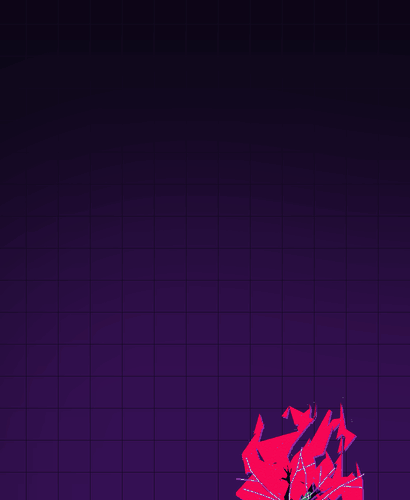

# Capricorn

### Capri from *Cyberpunk: Edgerunners*, alive on your Windows desktop.

She hears you, talks back in her own voice, and runs your PC for you.<br>
Her ears, her voice and her brain can all run on your own machine.

<br>

[](../../releases/latest)

[](Cargo.toml)
[](app/tauri.conf.json)
[](ui)
[](#requirements)
[](LICENSE)

[What she does](#what-she-does) &nbsp;·&nbsp; [Get started](#get-started) &nbsp;·&nbsp; [Her brains](#her-brains) &nbsp;·&nbsp; [From your phone](#from-your-phone) &nbsp;·&nbsp; [How it works](#how-it-works) &nbsp;·&nbsp; [FAQ](#faq) &nbsp;·&nbsp; [Build it](#build-from-source)

</div>

<br>

Capricorn is a desktop agent with a body. Capri floats over your windows, listens for her name and answers out loud.
Ask her for something and she does it on your PC: opens apps and clicks through them, plays music, reads your files,
looks things up. Then she checks that it really happened before she tells you it did.

It's a native Windows app written in **Rust** on **Tauri 2**, with her body drawn in **TypeScript** and **PixiJS**.

> [!TIP]
> She is optimized for **Claude Code** as her smart brain, even in hybrid mode (local + cloud). [Which brain to pick](#her-brains)

<br>

## What she does

<table>
  <tr>
    <td width="50%" valign="top">
      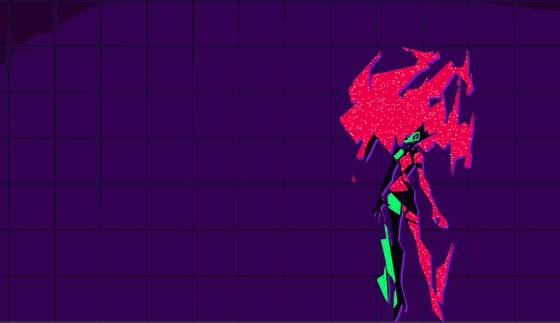<br>
      <b>She talks back.</b> Say "Capri" and ask, or type to her. She thinks, then answers in character and out
      loud, in a voice made on your PC. She keeps the last few minutes of the conversation in mind.
    </td>
    <td width="50%" valign="top">
      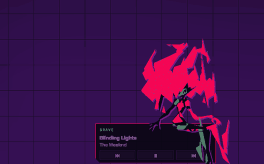<br>
      <b>She does it.</b> "Play Blinding Lights" and the song starts in YouTube Music. She checks Windows really
      reports it playing, then sits on her music deck and dances to the beat she hears.
    </td>
  </tr>
  <tr>
    <td width="50%" valign="top">
      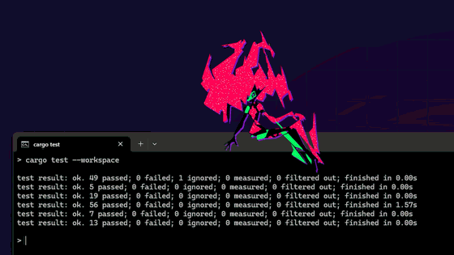<br>
      <b>She lives on your windows.</b> She sits on the window you're working in, can follow you across screens and
      rides your pointer when you ask.
    </td>
    <td width="50%" valign="top">
      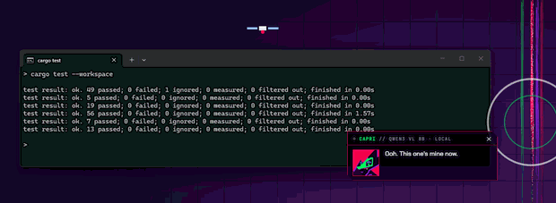<br>
      <b>She haunts them too.</b> Right-click her and she dives into a window and takes it over for a moment: eyes
      open all over it, a grin, a laugh, and she's back out.
    </td>
  </tr>
  <tr>
    <td width="50%" valign="top">
      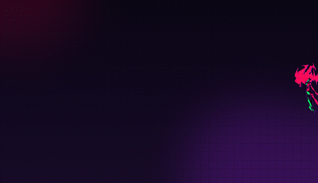<br>
      <b>Throw her around.</b> Grab her and fling her. She tumbles, cracks into the edge of your screen and crashes
      down. Pat her head and she's happy. She remembers how you treat her.
    </td>
    <td width="50%" valign="top">
      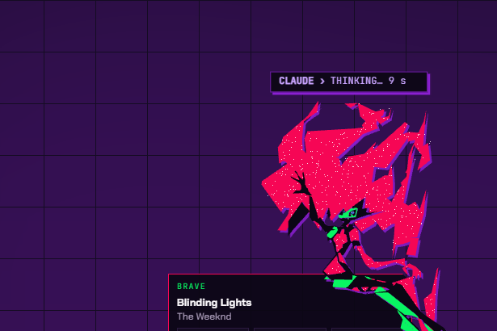<br>
      <b>She watches your coding agent.</b> While Claude Code works, what it's doing floats over her head. She
      cheers when it's done and comes to tell you when it's waiting on you.
    </td>
  </tr>
</table>

### Everything she can do

| | |
|---|---|
| **Apps and windows** | Open, focus, close, snap and minimize. Switch tabs. Press buttons and type into fields in any app through UI Automation, and when an app has nothing to read she looks at it and clicks what she sees. |
| **Music and video** | YouTube Music by default, YouTube or Spotify when you name them. Play, pause and skip. She can watch a video with you and react to it. |
| **Files** | Finds files by name or content and reads PDFs, Word documents, text and pictures. Drop a file on her and she tells you what's in it. |
| **The PC** | Volume, memory, disk and battery, dark mode, lock, sleep, restart or shut down on a timer. A shell command when nothing else fits. |
| **The web and your day** | Searches the web and reads pages, gives the weather at home, keeps reminders and timers. |
| **From your phone** | Message her on Discord when you're out: she does it on the PC and answers in the chat. [More below](#from-your-phone). |
| **Discord and games** | Mutes or deafens you in a call and stays quiet while you're in one. Notices when a game starts and goes quiet or stays reachable, your pick. |
| **Her own life** | Checks in on you (water, stretching, bedtime, a break from long games), has moods, remembers what you tell her about yourself, and gets closer to you over the days. |

<br>

## Get started

1. **[Download the installer](../../releases/latest)** and run it. No admin rights
   needed. Windows SmartScreen may warn you because the installer isn't code signed yet: choose **More info**, then
   **Run anyway**.
2. **First start:** she downloads her ears and voice (about 1 GB, once), with the progress in her panel.
3. **Her brain:** pick **Claude** in **Settings › Brain** (needs [Claude Code](https://claude.com/claude-code) and a
   Claude Pro or Max plan). She also offers a local brain through Ollama for talk and quick commands.

Then just talk to her:

| | |
|---|---|
| **"Capri, …"** | Her name, then what you want. "Capricorn" works too. |
| **Ctrl+Alt+V** | Hold to talk, or tap and she listens. |
| **Ctrl+Alt+T** | Type to her. |
| **Ctrl+Alt+W** | Listening for her name on or off. |
| **Ctrl+Alt+N** | Mute your mic for her. |
| **Ctrl+Alt+C** | Put her away, or bring her back. |
| **Ctrl+Alt+R** | She rides your pointer. |
| **Esc** | Stops whatever she's doing. |

Every key can be changed in **Settings › Keys**. Right-click her or her tray icon for the rest.

### Requirements

| | |
|---|---|
| **System** | Windows 10 or 11, 64-bit |
| **Disk** | About 1.5 GB, plus up to 8 GB for her brain on your PC |
| **Graphics** | A graphics card with 4 GB or more for her brain on your PC, 8 GB for the best one. None needed with an online brain. |
| **Microphone** | To talk to her. Typing works without one. |

<br>

## Her brains

| Smart brain | |
|---|---|
| **Claude Code** (Claude Pro or Max) | Best. What she's tuned for. |
| **NVIDIA** (free key) | Second. Fast, less reliable on long jobs. |
| **Cursor** (Cursor plan) | Slow with screenshots. |
| **Everything else** | Talk and simple jobs. Better support coming. |

She has three brains, each set in **Settings › Brain**:

| | |
|---|---|
| **Fast** | Talk and simple commands. Every request goes here first. |
| **Smart** | Jobs with several steps or inside an app. Optional. |
| **Eyes** | A vision model that finds what to click. Optional. |

Each can be:

| | |
|---|---|
| **On your PC** | Any model in **Ollama**, **LM Studio**, **llama.cpp** or **vLLM**: she lists what you have. Nothing leaves your PC. |
| **Your plan, no key** | Claude (Pro or Max, through Claude Code), Cursor, Codex (your ChatGPT plan) |
| **Free keys** | Groq, NVIDIA, Google Gemini, OpenRouter and Mistral, or Ollama Cloud with a sign-in |
| **Paid keys** | Claude API, OpenAI, DeepSeek |
| **Anything else** | Any OpenAI-compatible server, by its address |

Or type one by name:

```text
ollama/qwen3:14b                      a model in Ollama
lmstudio/…   llamacpp/…   vllm/…      a model in LM Studio, llama.cpp or vLLM
groq/llama-3.3-70b-versatile          any model of a provider you have a key for
http://127.0.0.1:5000/v1#my-model     any OpenAI-compatible server
```

Her default is Qwen3-VL on your PC, sized for your graphics card. A daily cap on cloud requests (200) keeps a paid brain
from running up a bill.

<p align="center">
  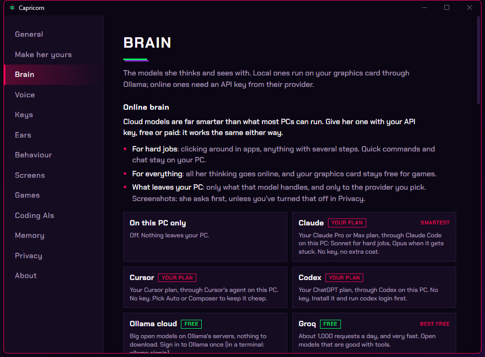
  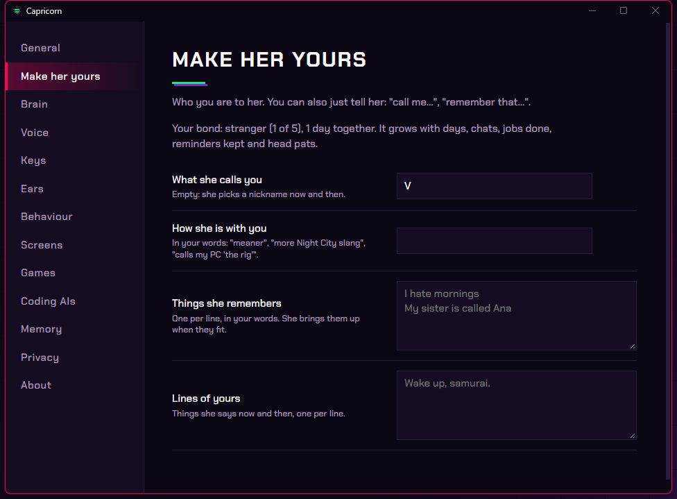
</p>

<br>

## From your phone

Out of the house and need something on the PC? Message her on Discord. She logs in as **your own Discord bot**, does
what you ask on the PC and answers in the chat, with "typing…" while she works.

- **"screenshot"** gets you a picture of the screen, **"stop"** stops whatever she's doing.
- Anything risky (closing an app by force, sending, deleting, running something) asks you for a **one-time code** in
  the chat first, and does nothing without it.
- She reads **only your messages** to your own bot, and it's off until you set it up. Settings › Phone walks you through
  making the bot in a few minutes.

<p align="center">
  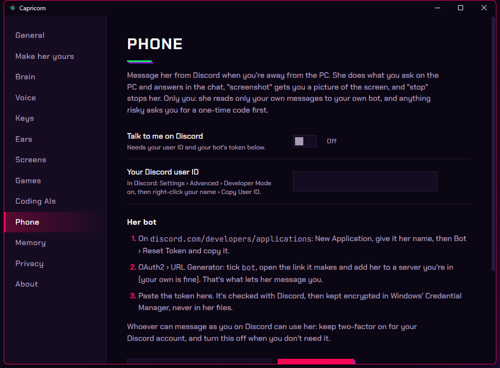
</p>

<br>

## Privacy

- Hearing and speaking happen on your PC: no audio ever leaves it, and none is kept.
- An online brain is used only when you pick one. Screenshots go to it only after she asks you, once per window.
- API keys and her Discord bot's token are stored in Windows Credential Manager, never in a file.
- Risky steps (deleting, installing, paying, admin rights, code from the internet) wait for your yes.
- Her journal of what she heard, decided and did stays on your PC, for you to read back or delete.

<br>

## How it works

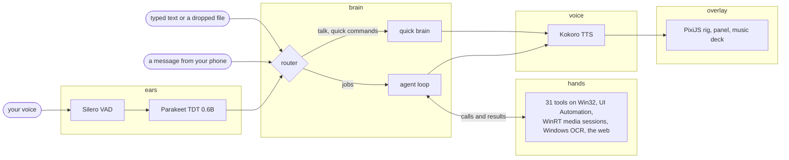

- **Rust from end to end.** A Tauri 2 app over a workspace of five crates (about 22k lines of Rust) and a TypeScript
  overlay (about 6.7k lines). One small native app: no Electron, no Python runtime.
- **Speech on the device.** [sherpa-onnx](https://github.com/k2-fsa/sherpa-onnx) runs Silero VAD and NVIDIA Parakeet
  for her ears and Kokoro for her voice, all on the CPU. Say her name while she talks and she stops mid-sentence.
- **An agent that checks its work.** Every tool answers ok, failed or unsure with the facts behind it. She tries
  another way when something fails, hands a job to the smart brain when the quick one gets stuck, and her spoken
  line is written only from what actually happened, so she never says "done" when nothing ran.
- **Real Windows control.** UI Automation reads and presses the controls of any app. WinRT media sessions tell her
  what's playing. Windows OCR and screenshots cover apps that draw their own UI. Global hotkeys, the tray, and
  Credential Manager for keys.
- **A body that belongs on the desktop.** Her rig is traced from a cut-out into bones and keyed poses (`art/trace`)
  and drawn with PixiJS 8. The overlay lets clicks through everywhere except her own outline, which is sent to Rust
  as polygons while she moves, so she never gets in your way. She perches on real window edges and dances to the
  beat of whatever your speakers play (WASAPI loopback and autocorrelation, in memory only).
- **Plans as brains.** Claude Code, Cursor and Codex run headless as her smart brain, so a subscription you already
  have works without an API key. Any OpenAI-compatible provider works with a key.
- **A phone line of her own.** Your own Discord bot, read over Discord's HTTP API with no extra service running.
  `tools/fake_discord.py` stands in for Discord to test it end to end without a bot.
- **Tested.** Unit tests across the workspace and Clippy with warnings as errors, on every push.

<br>

## FAQ

<details>
<summary><b>Windows says it protected my PC. Is the installer safe?</b></summary>
<br>
The installer isn't code signed yet, so SmartScreen doesn't know it. Choose <b>More info</b>, then <b>Run anyway</b>.
The whole source is here, and every release is built from it by GitHub Actions.
</details>

<details>
<summary><b>Is it free?</b></summary>
<br>
Yes, and open source (MIT). Her brain on your PC costs nothing. Online brains use your own key or plan, and several
providers have free keys (Groq, NVIDIA, Gemini).
</details>

<details>
<summary><b>Does she need the internet?</b></summary>
<br>
Only to download her models once. After that, with her brain on your PC, she hears, thinks and talks offline. Web
searches, the weather, music and online brains need the internet, of course.
</details>

<details>
<summary><b>Is she always listening?</b></summary>
<br>
She listens for her name on your PC; nothing is recorded, kept or sent. Ctrl+Alt+W turns listening for her name off,
Ctrl+Alt+N mutes your mic for her, and you can always just type.
</details>

<details>
<summary><b>Can she mess up my PC?</b></summary>
<br>
Anything risky (deleting, installing, sending, running programs, admin rights) waits for your yes, and Esc stops her
at any time. Blackwall mode in Settings lets the everyday risky steps through if you'd rather she just did them;
money, wiping data and code from the internet always ask.
</details>

<details>
<summary><b>How do I remove her completely?</b></summary>
<br>
Uninstall Capricorn from Windows Settings › Apps. Her settings and logs stay in <code>%APPDATA%\capricorn-engram</code>
and her models in <code>%LOCALAPPDATA%\capricorn-engram</code>: delete those folders too to remove everything.
</details>

<details>
<summary><b>Mac or Linux?</b></summary>
<br>
Windows only for now: her hands are built on Windows' own APIs.
</details>

<br>

## Build from source

You need Windows 10 or 11, [Rust](https://rustup.rs) (stable, 1.88 or newer), [Node.js](https://nodejs.org) 22 and the
Visual Studio C++ build tools. The first build downloads sherpa-onnx's prebuilt libraries.

```powershell
git clone https://github.com/theluckytiger/capricorn-engram.git
cd capricorn-engram
npm ci --prefix ui
ui\node_modules\.bin\tauri dev
```

- `ui\node_modules\.bin\tauri build` makes the installer in `target\release\bundle\nsis`.
- `cargo test --workspace` runs the tests.
- A dev build keeps her models in `models/`. Her logs are in `%APPDATA%\capricorn-engram\logs`, and
  `python tools/journal.py` reads her journal back as a story of what she heard, did and said.

### Project layout

| | |
|---|---|
| `app/` | The Tauri app: her windows, tray, hotkeys, first-start setup, listening and speaking, the phone bridge |
| `crates/core` | Settings, her journal, reminders, notes and the bond |
| `crates/brain` | The router, the agent loop, her persona and the model providers |
| `crates/hands` | Her tools, and the Windows layer under them |
| `crates/ears` | Microphone, wake word, speech to text, beat detection |
| `crates/voice` | Text to speech |
| `ui/` | Her overlay (rig, acting, effects, panel, music deck) and Settings |
| `art/` | The pipeline that traces her rig, her icon and the installer art |
| `tools/` | `journal.py` reads her journal back; `fake_discord.py` stands in for Discord in tests |

<br>

---

<div align="center">

Built by [**theluckytiger**](https://github.com/theluckytiger) · [MIT License](LICENSE)

<sub>Unofficial fan project, not affiliated with CD PROJEKT RED, Studio Trigger or Netflix, who own Capri and
<i>Cyberpunk: Edgerunners</i>. Her artwork isn't covered by the MIT license. Credits in <a href="CREDITS.md">CREDITS.md</a>.</sub>

</div>
